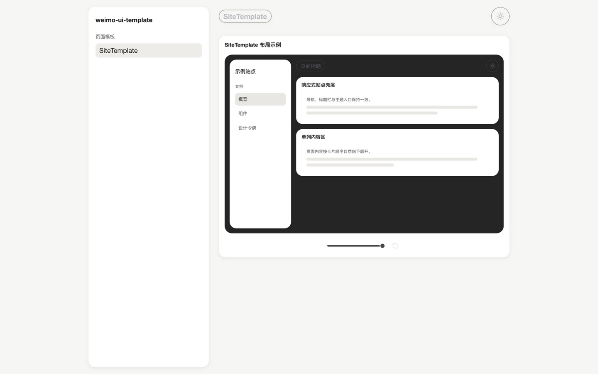
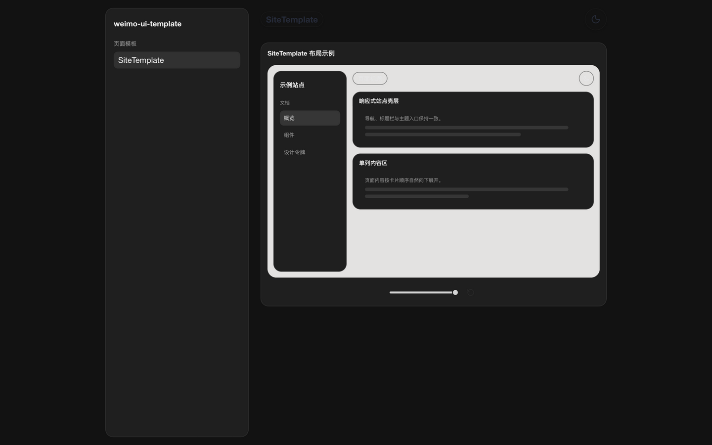
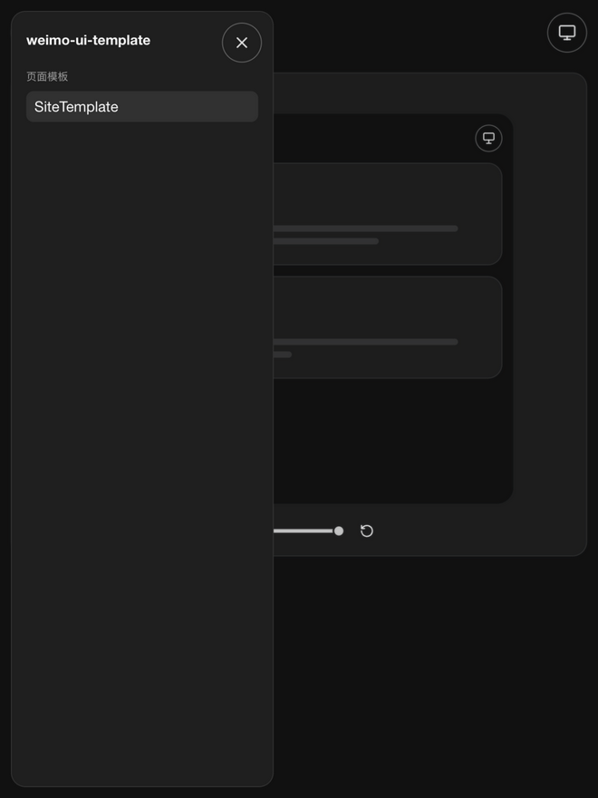

# Weimo UI Template

[](LICENSE)


**一个组件,给文档站装上完整的站点壳层。**

`weimo-ui-template` 为 Weimo UI 系列的文档站与独立预览站提供统一网页壳层:侧边栏、顶部栏、主题切换一次到位,你的站点只需专注写内容。Weimo UI 家族的每个站点外观一致、手感一致,用户在任何一个站里学会的导航方式,到下一个站依然适用。

**🔗 在线演示:<https://jiaowenjun.github.io/weimo-ui-template/>**



| 深色主题 | 窄屏抽屉 |
| :---: | :---: |
|  |  |

## 它给你什么

- **响应式站点壳层** —— 宽屏常驻侧边栏,窄屏自动折叠为抽屉式侧边栏,无需自己处理断点。
- **三态主题管理** —— `light` / `dark` / `system` 一键循环切换,自动监听系统偏好变化并同步 `dark` class。
- **开箱即用的顶栏** —— 左侧菜单按钮与页面标题、右侧主题切换按钮,还可通过 `topBarActions` 挂载自己的操作。
- **路由无关** —— 不绑定 React Router。站点保留自己的路由、catalog 与 Vite 配置,只把当前页面和导航回调交给模板。
- **统一设计语言** —— 基于 [`weimo-ui-core`](https://github.com/jiaowenjun/weimo-ui-core) 的毛玻璃组件构建,与 Weimo UI 组件库视觉一致。
- **自动文档标题** —— `siteName` 与 `pageTitle` 自动拼装 `document.title`,也可按需关闭自行管理。

## 快速开始

### 1. 安装

```bash
pnpm add weimo-ui-template weimo-ui-core @base-ui/react
```

如需固定版本,在包名后追加版本号(如 `pnpm add weimo-ui-template@0.3.2`)。

### 2. 引入基础样式

在应用入口先引 Core token、再引模板基础样式:

```css
@import "weimo-ui-core/styles/tokens.css";
@import "weimo-ui-template/styles/base.css";
```

不依赖 Tailwind:base.css 自带表单控件归一化(含按钮背景重置,与 Tailwind preflight 对齐),无 Tailwind 的项目开箱即用。已在用 Tailwind 的站点可继续保留 `@import "tailwindcss"`,放在上述导入之前即可,两者互不冲突。

### 3. 挂上 SiteTemplate

以 React Router 为例:

```tsx
import { Outlet, useMatch, useNavigate } from 'react-router'
import {
  SiteTemplate,
  type SiteNavigationGroup,
  type SiteNavigationItem,
} from 'weimo-ui-template/components/site-template'

const groups: SiteNavigationGroup[] = [
  {
    title: 'Components',
    items: [
      {
        id: 'tag-tree',
        label: 'TagTree',
        href: '/components/tag-tree',
      },
    ],
  },
]

export function DocsShell() {
  const navigate = useNavigate()
  const match = useMatch('/components/:componentId')
  const activeItemId = match?.params.componentId

  function openItem(item: SiteNavigationItem) {
    navigate(`/components/${encodeURIComponent(item.id)}`)
  }

  return (
    <SiteTemplate
      activeItemId={activeItemId}
      navigationGroups={groups}
      onNavigate={openItem}
      pageTitle="TagTree"
      siteName="weimo-ui-tagtree"
    >
      <Outlet />
    </SiteTemplate>
  )
}
```

导航项保留真实 `href`(可复制、可中键新开);提供 `onNavigate` 时,模板阻止整页跳转并把导航交给站点路由。

## SiteTemplate 常用 Props

| Prop | 说明 |
| --- | --- |
| `siteName` *(必填)* | 站点名,展示在侧边栏头部,并参与 `document.title` |
| `navigationGroups` | 侧边栏导航分组:分组标题 + 导航项(`id` / `label` / `href`);提供 `sidebar` 时可不传 |
| `sidebar` | 侧边栏自定义内容,提供后整体取代默认 `SiteNavigation`(应用型站点的富侧边栏) |
| `activeItemId` | 当前高亮的导航项 id |
| `onNavigate` | 导航项点击回调;提供后由站点路由接管跳转 |
| `pageTitle` | 顶栏与文档标题显示的当前页标题 |
| `topBarLeading` | 顶栏左侧前置插槽;提供后取代 `pageTitle` 标签(后者仍驱动 `document.title`),与右侧 `topBarActions` 对称 |
| `defaultTheme` / `theme` / `onThemeChange` | 主题控制:非受控默认值,或受控模式 + 变更回调 |
| `topBarActions` | 顶栏右侧自定义内容 |
| `sidebarHeader` | 侧边栏头部自定义内容(仅默认导航模式生效) |
| `manageDocumentTitle` | 是否自动维护 `document.title`,默认开启 |
| `scrollOnNavigate` | 导航后是否将内容区滚回顶部 |
| `contentClassName` / `contentProps` / `mainClassName` | 内容区扩展点 |

主题循环顺序为 `light → dark → system`,需要自行组合主题 UI 时,可从 `weimo-ui-template/components/site-template-model` 引入 `ThemeMode`、`getNextThemeMode` 等工具。单独渲染侧边栏可使用同入口导出的 `SiteNavigation`。

### 应用型站点:自定义侧边栏内容

文档站用 `navigationGroups` 声明导航即可;应用型站点(工作台、控制台)的侧边栏往往是富内容面板(统计、树、筛选器),把整块内容交给 `sidebar`,模板继续负责抽屉开合、顶栏、主题与布局占位:

```tsx
<SiteTemplate
  pageTitle="工作区"
  sidebar={<WorkspaceSideBar onSelect={handleSelect} />}
  siteName="my-app"
/>
```

提供 `sidebar` 时不再渲染默认导航,`navigationGroups` / `sidebarHeader` / `activeItemId` / `onNavigate` 随之失效;窄屏抽屉内的关闭按钮仍由模板提供。`sidebar` 也可传函数 `({ close }) => ReactNode`,富侧边栏在选中条目后调用 `close()` 收起窄屏抽屉,对齐默认导航的交互。

## MiniSiteTemplate 单页站壳

`MiniSiteTemplate` 是 `SiteTemplate` 的无侧边栏形态:顶栏 + 全宽内容(不限布局最大宽度,顶栏同步对齐),没有导航抽屉与侧栏占位。适合只有一个页面的站点(单组件演示站、单页文档)。演示:`/examples/mini-site-template`。

```tsx
import { MiniSiteTemplate } from 'weimo-ui-template/components/mini-site-template'

<MiniSiteTemplate pageTitle="WDF读写视图" siteName="weimo-ui-editor">
  <p>内容</p>
</MiniSiteTemplate>
```

与 `SiteTemplate` 同源的主题循环与 `document.title` 约定,`pageTitle` / `siteName` 仅驱动 `document.title`;顶栏左侧不显示页面标题,只渲染可选的 `topBarLeading` 前置插槽(与右侧 `topBarActions` 对称,如返回按钮)。`showThemeToggle={false}` 可隐藏右侧主题切换按钮(主题仍按 `defaultTheme` / `theme` 同步到 `html.dark`,默认跟随系统),把该位置让给站点自己的 `topBarActions`(如仓库链接)。可选 `headline` / `subheadline` 在内容区顶部渲染居中主标题与副标题,用于直接传达产品核心价值。支持 `siteName`、`pageTitle`、`headline` / `subheadline`、`defaultTheme` / `theme` / `onThemeChange`、`showThemeToggle`、`topBarActions`、`topBarLeading`、`manageDocumentTitle` 与 `contentClassName` / `contentProps` / `mainClassName` 扩展点,不含任何导航 Props。

## 页面内组件示例

模板不自带卡片组件,页面内的组件示例统一使用 `weimo-ui-core` 的标准预览卡:

```tsx
import { ComponentPreviewCard } from 'weimo-ui-core/components/component-preview-card'

<ComponentPreviewCard data-component-id="tag-tree" label="TagTree">
  <TagTree />
</ComponentPreviewCard>
```

需要自行组合标题、内容、页脚等卡片结构时,使用 `weimo-ui-core/components/base-card` 的 `BaseCard`。

## 本地跑起来

仓库内的 `site` 就是模板自身的文档与布局预览站,直接复用 `SiteTemplate`:

```bash
pnpm site:dev      # 开发,http://localhost:4179/weimo-ui-template/
pnpm site:build    # 构建
pnpm site:preview  # 预览构建产物
```

## 相关包

- [`weimo-ui-core`](https://github.com/jiaowenjun/weimo-ui-core) —— Weimo UI 基础组件与设计 token,本模板的构建基座

## 许可证

[MIT](LICENSE)
